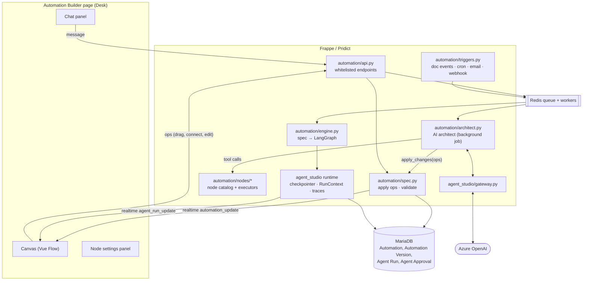

# Pridict Automation Builder: technical and implementation design

| | |
|---|---|
| Status | Draft for review |
| Date | 22 October 2026 |
| Owner | RiditStack |
| Module | Agent Studio (`pridict_app/pridict/agent_studio`, new package `pridict/automation`) |
| Depends on | Agent Studio runtime, LLM gateway, approvals, Runs page (all in production on UAT) |

---

## 1. Summary

Admins describe an automation in plain language ("When a Material Request is submitted, check
stock; if anything is short, create an RFQ for the approved suppliers and email them"). An AI
architect asks follow-up questions, then builds the automation as a graph. The graph is shown
as an n8n-style canvas directly under the chat, and the admin can change it either by prompting
or by editing the canvas. After one successful test run the admin activates it, and Pridict runs
it on real ERPNext events: document events, schedules, inbound email, webhooks or a manual start.

Everything is built into Pridict. There is no n8n or other third-party workflow engine (see
decision D1). The canvas uses Vue Flow, which Frappe v15 already ships. Execution reuses the
Agent Studio runtime: LangGraph with the MariaDB checkpointer, background jobs, Agent Run traces
and Agent Approvals.

---

## 2. Requirements (agreed 22 October 2026)

| # | Requirement | Answer |
|---|---|---|
| R1 | Users build workflows by prompting, as in a chat with Claude | Yes |
| R2 | The workflow is shown as an n8n-style graph under the prompt screen | Yes |
| R3 | Users can edit the graph | Yes, by prompting **and** directly on the canvas |
| R4 | Who builds | Mainly admins (System Manager or the new *Automation Manager* role) |
| R5 | Scope | Any ERPNext DocType or module |
| R6 | Triggers | All: document events, schedules, inbound email, webhooks, manual/chat |
| R7 | Actions | May create, update and **submit** documents and **send email to external parties** |
| R8 | Activation gate | One successful test run is enough (no second approver) |
| R9 | Quality bar | Production feature, sold to RiditStack clients and set up per client |

### Decisions

| ID | Decision | Reason |
|---|---|---|
| D1 | **Build our own canvas and engine (Option A). Do not use n8n.** | n8n's Sustainable Use License does not allow "external end users to build or configure their own workflows through your product", even behind a custom UI. Selling Pridict to clients with an embedded n8n editor would need an n8n Enterprise licence (price not public). Our own engine also keeps the Agent Studio guardrails: permissions, approvals, audit. |
| D2 | Call the feature **Automations**, not Workflows | ERPNext already has a *Workflow* DocType (document approval states) with its own Workflow Builder. Reusing the name would confuse users and support staff. |
| D3 | The automation **spec (JSON) is the single source of truth** | The chat and the canvas both edit the same spec through the same operations, so they never drift apart. The runtime compiles the same spec. |
| D4 | Run on the existing Agent Studio runtime (LangGraph + MariaDB checkpointer) | Durable pause and resume for approvals and waits already exists and has tests. No new infrastructure. |
| D5 | No free-form code nodes in v1 | Arbitrary Python or JavaScript authored through a prompt is a remote-code-execution risk on a multi-client product. Conditions and templates use Frappe's restricted evaluators. |

### Out of scope for v1

- Non-admin users building automations (they receive approvals, notifications and documents).
- A template marketplace. A small set of starter templates is in scope (Phase 5).
- Moving the existing Procurement Sourcing Agent onto the new engine.
- Connectors for third-party SaaS (Slack, Google Sheets and so on). A generic **HTTP Request** node
  covers outside systems in v1.
- Sharing automations across client sites. Each client site has its own automations; export and
  import as JSON is in scope.

---

## 3. What exists today and what we reuse

| Existing piece | File | Reused for |
|---|---|---|
| LLM gateway (Azure OpenAI, retries, fallback, structured output, token accounting) | `agent_studio/gateway.py` | The AI architect and the *AI Step* node |
| Tool-calling conversation loop running as the user in background jobs | `agent_studio/conversation.py` | Pattern for the builder chat (new `automation/architect.py`) |
| Graph compiler: registry → LangGraph `StateGraph` | `agent_studio/runtime.py:278` `build_graph` | Generalised to compile an automation spec |
| MariaDB checkpointer (durable interrupts) | `agent_studio/checkpointer.py` | Approval, Ask and Wait nodes |
| Static graph checks (reachability, dead ends, unguarded cycles) | `agent_studio/graph.py` | Spec validation |
| Run trace (`Agent Run`, `Agent Run Step`), realtime `agent_run_update` | DocTypes and `runtime.py` | Automation run history and live canvas highlighting |
| Approvals with role coverage and self-approval block | `agent_studio/approvals.py`, `Agent Approval` | *Approval* node |
| Tool registry and argument validation | `agent_studio/tools.py` | Pattern for the node catalog and config validation |
| Offline eval harness (fixtures built, then rolled back) | `agent_studio/evals.py` | Test runs inside a rolled-back transaction |
| Hourly maintenance (orphaned or stale runs) | `agent_studio/maintenance.py` | Run retention, auto-pause |
| Read-only *Workflow Designer* page | `pridict/page/agent_workflows` | Replaced by the new Automations pages |
| Vue 3, `@vue-flow/core`, `@vue-flow/background` | Frappe v15 `package.json` | The canvas, with no new dependency |

---

## 4. Architecture



### 4.1 One spec, two editors

The chat and the canvas never edit each other. Both send the same **operations** (Section 6.3)
to `spec.apply_ops()`. The server:

1. checks the draft's `revision` matches the editor's base revision, or rejects the operations
   as a conflict so the editor reloads;
2. applies the operations to a copy of the spec;
3. validates the result (Section 6.4);
4. saves it with `revision + 1` and an entry in the change log (who, chat or canvas, which ops);
5. publishes `automation_update` over Socket.IO so every open editor redraws.

The AI architect always receives the current spec at the start of each turn, so it sees canvas
edits made since its last message.

---

## 5. Data model

All new DocTypes live in the existing **Pridict** module (`pridict/pridict/doctype/`), next to the
Agent Studio DocTypes, as in the file layout in Section 15.

### 5.1 `Automation`

| Field | Type | Notes |
|---|---|---|
| `title` | Data | Shown in lists |
| `description` | Small Text | Plain-language summary, kept up to date by the architect |
| `status` | Select | `Draft` · `Active` · `Paused` · `Disabled` · `Archived` |
| `draft_spec` | JSON | The version being edited |
| `draft_revision` | Int | Optimistic concurrency counter |
| `active_version` | Link → Automation Version | What the triggers run; empty until first activation |
| `trigger_type` | Select (read-only, from spec) | Indexed copy for fast trigger lookup |
| `trigger_doctype` | Link → DocType (read-only) | Indexed |
| `trigger_event` | Data (read-only) | e.g. `on_submit` |
| `run_as` | Link → User | Identity runs execute as (Section 9.1) |
| `conversation` | Link → Assistant Conversation | The builder chat |
| `max_runs_per_hour` | Int | Default 60 |
| `max_emails_per_day` | Int | Default 200 |
| `consecutive_failures` | Int | Auto-pause at 5 (configurable) |
| `last_run_at`, `last_run_status` | Datetime, Data | List view |

### 5.2 `Automation Version` (immutable once created)

| Field | Type | Notes |
|---|---|---|
| `automation` | Link | |
| `version` | Int | 1, 2, 3 … |
| `spec` | JSON | Frozen copy |
| `spec_hash` | Data | SHA-256 of the canonical spec; ties a test run to an exact spec |
| `test_run` | Link → Agent Run | The passing test run that unlocked activation |
| `activated_by`, `activated_at` | Link, Datetime | |
| `change_note` | Small Text | Written by the architect, editable |

Runs record the version they started on, so in-flight runs finish on the version they began even
if a newer version is activated meanwhile.

### 5.3 Changes to existing DocTypes

- **Agent Run**: add `automation` (Link), `automation_version` (Link), `trigger_doctype` (Link),
  `trigger_name` (Dynamic Link), `is_test` (Check). The existing Runs page, step trace, realtime
  and retention all keep working.
- **Agent Run Step**: add `node_id` (Data) so the canvas can colour each node by status.
- **Assistant Conversation**: add `purpose` (Select: `Assistant` · `Automation Builder`).
- **Agent Approval**: no schema change. Automation approvals use `action = "automation:<node>"`.

### 5.4 Roles

- **Automation Manager**: create, edit, test, activate and pause automations. Given to System
  Managers on install.
- **Automation Viewer**: read automations and run history. For support and auditors.

---

## 6. The automation spec

### 6.1 Format

```json
{
  "schema": 1,
  "title": "Short-stock MR → RFQ",
  "trigger": {
    "id": "trigger",
    "type": "trigger.document_event",
    "config": { "doctype": "Material Request", "event": "on_submit",
                "condition": "doc.material_request_type == 'Purchase'" },
    "position": [0, 0]
  },
  "nodes": [
    { "id": "stock", "type": "data.find_documents",
      "label": "Stock for requested items",
      "config": { "doctype": "Bin",
                  "filters": [["item_code", "in", "{{ trigger.doc.items | map(attribute='item_code') | list }}"]],
                  "fields": ["item_code", "warehouse", "actual_qty", "projected_qty"] },
      "position": [0, 140] },
    { "id": "short", "type": "logic.if", "label": "Anything short?",
      "config": { "condition": "any(r.projected_qty < 0 for r in nodes.stock.rows)" },
      "position": [0, 280] },
    { "id": "rfq", "type": "action.create_document", "label": "Create RFQ",
      "config": { "doctype": "Request for Quotation", "submit": true, "values": { "...": "..." } },
      "position": [-160, 420] },
    { "id": "mail", "type": "action.send_email", "label": "Email suppliers",
      "config": { "to": "{{ nodes.rfq.doc.suppliers | map(attribute='email_id') | join(',') }}",
                  "subject": "RFQ {{ nodes.rfq.doc.name }}", "template": "..." },
      "position": [-160, 560] }
  ],
  "edges": [
    { "from": "trigger", "to": "stock" },
    { "from": "stock", "to": "short" },
    { "from": "short", "to": "rfq", "branch": "true" },
    { "from": "short", "to": "END", "branch": "false" },
    { "from": "rfq", "to": "mail" },
    { "from": "mail", "to": "END" }
  ],
  "settings": { "on_error": "stop_and_notify", "max_steps": 50 }
}
```

### 6.2 Expressions

| Where | Engine | Example |
|---|---|---|
| Text fields (`subject`, `values`, `to`) | Frappe Jinja (`frappe.render_template`, sandboxed) | `{{ trigger.doc.supplier_name }}` |
| Conditions (`logic.if`, trigger `condition`, `logic.switch` cases) | `frappe.safe_eval`, the same restricted evaluator Frappe Notifications use | `doc.grand_total > 100000` |

The evaluation context is `trigger` (event, `doc`, `doc_before_save` for changes), `nodes`
(outputs of finished nodes, by id), `vars` (values from *Set Variable*), `run` (name, started_at,
is_test) and `now` / `today`. No Python builtins beyond the safe_eval whitelist. Values from
documents are always passed as data and never concatenated into code.

### 6.3 Operations (the only way to change a spec)

| Op | Payload |
|---|---|
| `set_trigger` | `type`, `config` |
| `add_node` | `id?`, `type`, `label`, `config`, `after?` (node id to connect from), `branch?` |
| `update_node` | `id`, `label?`, `config_patch` (JSON merge patch) |
| `remove_node` | `id`, `reconnect: bool` (join its parent to its child) |
| `connect` | `from`, `to`, `branch?` |
| `disconnect` | `from`, `to`, `branch?` |
| `move_node` | `id`, `position` (canvas only) |
| `set_settings` | `settings_patch` |
| `set_meta` | `title?`, `description?` |

Every op batch is logged with source (`ai` / `canvas`), user and revision, which gives undo,
history and a readable diff ("AI added *Manager approval* between *Create PO* and *Submit PO*").

### 6.4 Validation (on every save)

Structural checks (extending `agent_studio/graph.py`):

- exactly one trigger; every node reachable from it; every path ends at `END`;
- every edge target exists; branch labels match the node type (`true`/`false` for If; the case
  names for Switch);
- no cycle that doesn't pass through a *Loop* node or a *Wait*/*Approval* pause;
- `max_steps` within the site limit.

Semantic checks (against live metadata, as the editing user):

- referenced DocTypes and fields exist (`frappe.get_meta`), and Link values point to the right
  DocType;
- the action is possible on that DocType: `submit: true` only for submittable DocTypes, no create
  on single or virtual DocTypes;
- templates and conditions parse (Jinja `parse`, safe_eval compile);
- referenced nodes in `{{ nodes.x }}` exist and run before the current node on every path;
- email: the account exists and the recipient expression is present;
- `run_as` has the permissions every action needs (`frappe.has_permission(doctype, ptype, user=run_as)`).

Results are a list of `{node_id, level: error|warning, message}`. Errors block test runs and
activation. The canvas marks the node red or amber; the architect receives the same list and is
asked to fix errors before replying.

---

## 7. Node catalog (v1)

Each node type is a Python class in `automation/nodes/` with `type`, `label`, `category`,
`config_schema` (JSON Schema, also used to build the settings form and the AI's tool
definitions), `outputs` (what other nodes can reference), `branches`, and `execute(ctx, config)`.
The catalog is code; the architect gets it through the `get_node_catalog` tool.

| Category | Type | Purpose | Output |
|---|---|---|---|
| **Trigger** | `trigger.document_event` | `after_insert`, `on_update`, `on_submit`, `on_cancel`, `on_trash`, `on_change` + optional field-changed list + condition | `trigger.doc`, `trigger.doc_before_save` |
| | `trigger.schedule` | Cron expression or friendly picker (every day 09:00, every Monday…) in the site timezone | `trigger.fired_at` |
| | `trigger.inbound_email` | Email received on a chosen Email Account; optional subject/sender filter | `trigger.email` (from, subject, body, attachments) |
| | `trigger.webhook` | POST to a unique URL with a secret | `trigger.body`, `trigger.headers` |
| | `trigger.manual` | Button in the list view or a chat command | `trigger.input` |
| **Data** | `data.get_document` | Load one document by name | `doc` |
| | `data.find_documents` | Filtered list (fields, filters, order, limit ≤ 500) | `rows`, `count` |
| | `data.aggregate` | Sum, count or average grouped by a field | `rows` |
| | `data.run_report` | Run a Query Report or Script Report with filters | `columns`, `rows` |
| **Logic** | `logic.if` | Condition → `true` / `false` branches | – |
| | `logic.switch` | Named cases, plus `default` | – |
| | `logic.loop` | For each row of a list, run the body branch, then `done` | `index`, `item` per iteration |
| | `logic.set_variable` | Compute and store a value | `vars.<name>` |
| | `logic.wait` | Wait for a duration or until a date, or until a document reaches a status | – |
| | `logic.stop` | End the run with a status and message | – |
| **Action** | `action.create_document` | Create a document; optional submit | `doc` |
| | `action.update_document` | Set fields on a document; optional submit | `doc` |
| | `action.submit_document` | Submit a draft document | `doc` |
| | `action.cancel_document` | Cancel a submitted document (warning on the canvas) | `doc` |
| | `action.send_email` | Email through an Email Account; Jinja or Email Template; attach a print format PDF | `message_id` |
| | `action.notify` | In-app notification (Notification Log) to users or a role | – |
| | `action.assign` | Create a ToDo assignment | `todo` |
| | `action.add_comment` | Comment on a document's timeline | – |
| | `action.http_request` | Call an outside URL (GET/POST/PUT), secrets from *Automation Credential* | `status`, `body` |
| **Human** | `human.approval` | Agent Approval to a role or users; `approved` / `rejected` / `expired` branches; timeout | `decision`, `decided_by`, `note` |
| | `human.ask` | Ask a user a question (notification + reply form); answer stored | `answer` |
| **AI** | `ai.step` | Classify, extract, summarise or draft text through the gateway with a JSON output schema | `result` |

**Not in v1:** code nodes (D5), sub-automations, parallel branches that join (`merge`). Branches
are exclusive in v1, which keeps the LangGraph mapping one-to-one.

---

## 8. The AI architect

`automation/architect.py` follows the `conversation.Turn` pattern: each admin message enqueues a
background job that runs as that admin and calls the gateway in a tool-calling loop (maximum 8
rounds).

### 8.1 Context given to the model each turn

- the system prompt: role, rules (Section 8.3), the operation format, the expression syntax;
- the node catalog: type, purpose, `config_schema` (compact form, about 6k tokens);
- the current draft spec + its revision + current validation results;
- the last 30 chat messages.

### 8.2 Tools

| Tool | What it does |
|---|---|
| `search_doctypes(query)` | Finds DocTypes by name, module or description. Only DocTypes the admin may read. |
| `get_doctype_fields(doctype)` | Fields, types, options, required, submittable, child tables (from `frappe.get_meta`). Where available, uses Schema Intelligence's relationship data for "which DocType links to what". |
| `get_sample_document(doctype)` | One recent document, so the model sees real values. Fields hidden from the admin are removed. |
| `list_users_and_roles(query)` / `list_email_accounts()` / `list_print_formats(doctype)` / `list_reports(query)` | Lookups for node settings |
| `validate_expression(expr, kind, at_node)` | Checks a template or condition before using it |
| `apply_changes(ops, summary)` | Applies operations to the draft (Section 4.1). Returns the new spec revision and validation results, or a conflict. |
| `ask_user(question, choices?)` | Ends the turn with a question, optionally with quick-reply buttons |

### 8.3 Rules in the system prompt

1. Ask before guessing anything that changes data or emails people: recipients, amounts and
   thresholds, whether to submit or keep as draft.
2. Prefer the smallest graph that does the job; use real DocType and field names from the tools,
   never invented ones.
3. After `apply_changes`, fix every validation error before replying.
4. Explain each change in one or two sentences the admin can check against the canvas.
5. Warn when a request would duplicate an existing ERPNext feature (Notification, Assignment
   Rule, Auto Repeat) and ask which one the admin wants.
6. Never put document values into conditions as code; reference them through `trigger.` and
   `nodes.`.

### 8.4 Model

The architect needs stronger reasoning than the Procurement Assistant. Add an LLM Model Config
`automation-architect`.

- **Development and testing:** the existing `procurement-reasoning` config (Azure `gpt-5.4-mini`),
  as agreed on 22 October 2026. No new Azure deployment is needed to build and test the feature.
- **Recommended for production:** a full-size GPT-5.4 deployment (the larger sibling of the mini
  model), `reasoning_effort: medium`, with `procurement-reasoning` as fallback. It plans
  multi-step graphs and picks the right fields more reliably. Confirm availability in our Azure
  region and compare both models on the architect eval set (Section 14) before switching. The cost per build session is roughly 30–60k
tokens; the existing token accounting on the conversation reports it.

### 8.5 Example exchange

> **Admin:** When a sales invoice is 7 days overdue, email the customer a reminder and tell the
> account manager.
>
> **Architect:** *(calls `get_doctype_fields("Sales Invoice")`, `list_email_accounts()`)* A few
> questions: (1) Should it repeat (for example at 7, 14 and 30 days), or remind once? (2) Send
> from *accounts@riditstack.com*? (3) "Account manager": the invoice's *Sales Person*, or a
> fixed user?
>
> **Admin:** Once. Yes. The customer's account manager field.
>
> **Architect:** *(calls `apply_changes` with 5 ops)* Done. It runs every day at 09:00, finds
> unpaid invoices whose due date was exactly 7 days ago, emails each customer's billing contact,
> and sends the account manager an in-app notification. Before activating, run a test: pick an
> overdue invoice and I'll show what would be sent.

---

## 9. Execution engine

### 9.1 Run identity and permissions

Every run executes as the automation's **Run As** user (`frappe.set_user(run_as)` inside the
job), with **no** `ignore_permissions`. Permission errors fail the node with a clear message.

- Default Run As: a dedicated system user per site, `automation@<site>`, created on install with no
  roles. The admin grants it roles per need, which keeps privileges visible in one place.
- An admin can only choose a Run As user whose roles are a subset of their own (prevents
  privilege escalation through automations).
- Documents created by runs record `owner = run_as` and a timeline comment "Created by
  automation *X* (run AGR-…)".

### 9.2 Compiling a spec

`engine.compile(version)` turns the frozen spec into a LangGraph `StateGraph`, cached per
`spec_hash`:

- each node becomes a LangGraph node wrapping `NodeType.execute`, inside the existing
  `RunContext` step bookkeeping (`begin_step` / `end_step`, now with `node_id`);
- single edges become `add_edge`; branching nodes return `{"route": "<branch>"}` and use
  `add_conditional_edges`, exactly like `runtime.build_graph` today;
- `human.approval`, `human.ask` and `logic.wait` raise LangGraph `interrupt`s, so the
  checkpointer saves state and the job ends;
- `logic.loop` compiles into a counter in state plus a conditional edge back to the loop head
  (LangGraph `recursion_limit` is set from `max_steps`).

State holds `trigger`, `nodes` (outputs by id), `vars`, `route` and the loop counters. Node outputs
are capped (rows ≤ 500; strings truncated at 100 kB) to keep checkpoints small.

### 9.3 Triggers

| Trigger | Mechanism |
|---|---|
| Document event | `hooks.py` `doc_events = {"*": {event: "pridict.automation.triggers.on_doc_event"}}`. The handler looks up `(doctype, event)` in a Redis-cached index of active automations (rebuilt on activate/pause), so non-matching saves cost a dictionary lookup. Matching automations are enqueued **after commit** (`enqueue_after_commit=True`) with the document name, not a copy, so rolled-back saves never trigger runs. |
| Schedule | `scheduler_events["cron"]["* * * * *"]` runs a dispatcher once a minute. It evaluates each active schedule's cron (`croniter`, already a Frappe dependency) and enqueues due runs. A per-automation `last_fired_at` prevents double firing. |
| Inbound email | `doc_events["Communication"]["after_insert"]` for received emails on the selected Email Account. |
| Webhook | `POST /api/method/pridict.automation.triggers.webhook?key=<automation>` (`allow_guest`), HMAC-SHA256 signature check against a per-automation secret, Frappe `rate_limit`, body ≤ 1 MB. |
| Manual | List-view button and chat command, as the clicking user (who needs the Run As permission check). |

### 9.4 Guardrails during runs

| Risk | Control |
|---|---|
| Infinite loops (automation A updates a doc that triggers A again) | `frappe.flags.automation_chain` carries the chain of automation ids. A run never triggers itself and the chain depth is capped at 3. |
| Runaway volume | `max_runs_per_hour` per automation (Redis counter); excess events are dropped and logged, and the owner is notified once. |
| Email flooding | `max_emails_per_day` per automation and a site-wide cap; optional recipient domain allowlist. |
| Bad automation in production | Auto-pause after N consecutive failures, with notification to the owner. A global kill switch in *Automation Settings* pauses every automation. |
| Slow or hanging node | Per-node timeout (HTTP 30 s, AI 120 s); run `max_runtime_s`; `maintenance.hourly` fails orphaned runs. |
| Starving other jobs | Automation runs go to their own RQ queue `automation`, with a dedicated worker in production (Section 12). |
| Partial failure | `settings.on_error`: `stop_and_notify` (default) or `continue`; per-node `retry` (count + backoff) for HTTP and email. Each node commits its own work, so a failure after *Create RFQ* leaves the RFQ and the trace shows exactly where it stopped. |

### 9.5 Pausing and resuming

- **Approval**: creates an Agent Approval (existing inbox, notifications, role coverage,
  self-approval block). `approvals.decide` resumes the run through `runtime.resume_run`.
- **Ask**: notification with a reply link; the answer resumes the run.
- **Wait**: stores `resume_at` on the Agent Run; `maintenance` (moved to every 5 minutes) resumes
  due runs. *Wait until document status* subscribes to that document's `on_update` through the
  same trigger index.

---

## 10. Test runs and activation

R8: one successful test run is enough to activate.

1. The admin clicks **Test run**. For document triggers they pick an existing document (or let the
   architect create sample data). For schedules, the run uses the current time; for webhook and
   email triggers, a sample payload.
2. The run executes the real compiled graph as Run As, **inside a database transaction that is
   rolled back at the end** (the same approach `evals.py` uses). Created and submitted documents,
   comments and assignments are therefore real during the run and gone afterwards.
3. Side effects outside the database are captured, not performed:
   - emails are rendered and shown on the run ("would send to …, subject …, body …") but not sent;
   - HTTP requests: `GET` is performed only if the node is marked *safe in tests*; otherwise the
     admin provides a sample response;
   - Approval / Ask / Wait nodes pause and offer **Simulate approve / reject / answer / skip wait**
     buttons so the admin can drive each branch.
4. The canvas animates the run live (`agent_run_update` with `node_id`): green for done, red for
   failed, grey for not reached. Each node shows its inputs and outputs on click.
5. A test **passes** when it reaches `END` without errors. The passing run is stored on a new
   *Automation Version* together with the exact `spec_hash`.
6. **Activate** is enabled only when the draft's `spec_hash` equals the hash of a passing test
   run. Any later edit changes the hash and requires a new test run. The canvas shows which
   nodes the passing test did not reach, so the admin can decide whether to test other branches.

Limitation to accept: the rollback approach cannot test behaviour that depends on a separate
commit (for example a background job started by ERPNext during submit). Those effects are listed
as "deferred, not tested" in the run.

---

## 11. User interface

### 11.1 Automation Builder page (`/app/automation-builder/<name>`)

```
┌──────────────────────────────────────────────────────────────────────────────┐
│ Short-stock MR → RFQ          Draft · v3 · rev 41     [Validate] [Test run]  │
│                                                       [Activate] [⋯]         │
├──────────────────────────────────────────────────────────────────────────────┤
│ CHAT                                                                         │
│  You: also email the purchase manager if the RFQ total estimate > ₹5L        │
│  AI:  Added "Estimate > ₹5L?" after "Create RFQ" and an email to the         │
│       Purchase Manager role on the yes branch. ✓ No validation errors.       │
│  [ Describe a change…                                          ] [Send]      │
├──────────────────────────────────────────────────────────────────────────────┤
│ CANVAS                                         [Fit] [Auto-layout] [History] │
│      ┌──────────────────┐                                                    │
│      │⚡ MR submitted    │                                                    │
│      └────────┬─────────┘                                                    │
│      ┌────────▼─────────┐            ┌─────────────────────────────────┐     │
│      │🔎 Stock for items│            │ NODE: Create RFQ                │     │
│      └────────┬─────────┘            │ DocType  [Request for Quotation]│     │
│      ┌────────▼─────────┐            │ Submit   [✓]                    │     │
│      │◆ Anything short? │            │ Items    {{ nodes.stock.rows }} │     │
│      └──yes──┬──no──────┘            │ ...                             │     │
│      ┌───────▼──────────┐    END     │ [Ask AI about this node]        │     │
│      │➕ Create RFQ      │            └─────────────────────────────────┘     │
│      └───────┬──────────┘                                                    │
└──────────────────────────────────────────────────────────────────────────────┘
```

- Chat on top, canvas below (R2). A draggable divider; the canvas can go full screen.
- Canvas built with **Vue Flow** inside a Frappe page bundle (`automation_builder.bundle.js`).
  Custom node components per category (icon, colour, label, status dot, validation badge).
- Editing on the canvas: drag to move, drag from a handle to connect, delete key, a **+** button
  on edges opens a node picker (search the catalog), double-click opens the settings panel.
- The settings panel is generated from each node's `config_schema`, using `frappe.ui.FieldGroup`
  controls so Link fields get normal Frappe autocomplete (DocType, User, Email Account…). Template
  fields get a small expression picker listing the available `trigger.` / `nodes.` values.
- **Ask AI about this node** puts the node into the chat context ("change *Create RFQ* to keep it
  as a draft").
- Auto-layout: a small in-house layered layout (top to bottom, branches side by side), used when
  the AI adds nodes. Positions the admin sets by dragging are kept.
- History: list of op batches with source and diff; restore any earlier revision as a new
  revision.
- Read-only mode for *Automation Viewer* and for active versions (editing an active automation
  edits its draft; the active version keeps running until the new one is activated).

### 11.2 Automations list (`/app/automations`)

Cards or table: title, trigger summary ("Material Request · on submit"), status, active version,
runs in the last 24 h, failures, last run. Actions: open, pause/resume, duplicate,
export/import JSON, **New automation** (opens the builder with an empty chat and starter
suggestions).

### 11.3 Runs

The existing **Agent Runs** page gains an *Automation* filter. Opening an automation run shows
the canvas with the path taken and each node's inputs, outputs, duration and error.

---

## 12. Deployment and operations

- **No new services.** Everything runs in the existing Frappe containers. MariaDB, Redis and
  Socket.IO are already there.
- **Worker:** add the `automation` queue to Frappe's `workers` config and a `worker-automation`
  service in `deployment/compose.yaml` (same image, `bench worker --queue automation`). On small
  client sites the default worker can also listen to `automation`.
- **Scheduler:** already running; the new per-minute cron entry is light.
- **Migrations:** new DocTypes, Agent Run fields, roles, the `automation@<site>` user, Automation
  Settings defaults and the `automation-architect` model config are created in
  `after_migrate` (idempotent, like `agent_studio/setup.py`).
- **Retention:** automation run traces are kept 30 days by default (configurable); failed runs 90
  days. `maintenance` purges older traces and checkpoints.
- **Monitoring:** an *Automation Health* panel on the Agent Studio home: runs per hour, failure rate,
  paused-by-guardrail list, queue length, email volume.
- **Release:** the existing Azure release scripts (snapshot → backup → `release-pridict.sh` →
  verify). Feature flag `automation_builder_enabled` in Automation Settings, off by default, so it
  can be shipped dark and enabled per client.
- **Per-client setup:** each client site has its own automations. JSON export/import moves an
  automation between sites (for example from a client's test site to production); validation
  re-runs on import against that site's metadata.
- **Docs:** `documentation/automation-builder/OPERATIONS.md` (admin guide) and an explainer PDF in
  the style of the Agent Studio explainer.

---

## 13. Security review checklist

| Area | Control |
|---|---|
| Code execution | No code nodes. Jinja sandboxed; conditions through `frappe.safe_eval`. Templates are validated at save and at run. |
| Privilege escalation | Run As roles ⊆ activating admin's roles; runs never use `ignore_permissions`; only Automation Manager can edit or activate. |
| Data leakage to the LLM | Architect tools run as the admin and strip fields the admin can't read. Sample documents are optional and limited to one record. The *AI Step* node sends only the fields its template references. |
| Prompt injection | Document content (for example an inbound email body) reaches the LLM only inside *AI Step* nodes, whose output is schema-validated data. It never edits the spec or chooses actions. The architect reads metadata, not business content, except the optional sample document. |
| Webhooks | Unguessable per-automation key + HMAC signature + rate limit + size limit; secret rotation button. |
| Outbound HTTP | URL allowlist per site (Automation Settings); private IP ranges and `localhost` blocked (SSRF); credentials kept in an encrypted Password field on *Automation Credential*, never shown to the LLM. |
| Email | Only configured Email Accounts; per-automation and site caps; every sent email linked to the run. |
| Audit | Every spec change (who, chat or canvas, ops), activation, pause and run is recorded; Agent Run steps keep inputs and outputs per node. |

---

## 14. Testing strategy

| Level | What | Where |
|---|---|---|
| Unit | Spec ops, validation rules, expression evaluation, compiler mapping, each node executor | `automation/test_*.py` (pattern: `agent_studio/test_*.py`) |
| Integration | Triggers end-to-end on ERPNext test records: doc event → run → documents and emails; approvals pause/resume; loop guard; rate limits; rollback test runs | Same, using `_Test Company` fixtures |
| Architect | Scripted-LLM tests for the tool loop (like `fake_llm_worker`), plus a **live eval set** of 20 prompts (the scenarios below plus variations) scored on: valid spec, correct DocTypes and fields, asks the right questions, passes a test run | `automation/evals.py`, reusing the Agent Evaluation DocType |
| UI | Playwright: create by chat, edit on canvas, chat sees the edit, test run animation, activate | `~/agent-studio-scratch` scripts promoted into `pridict/tests/ui` |
| Load | 1,000 document saves per minute with 20 active automations: trigger overhead < 2 ms per save; dispatcher latency < 5 s | Dev bench, before Phase 5 release |

### Acceptance scenarios

| # | Prompt (abridged) | Covers |
|---|---|---|
| S1 | "When a Material Request is submitted, check stock; if short, create and submit an RFQ for the approved suppliers and email them." | Doc event, find, if, create + submit, external email |
| S2 | "Every day at 9, email customers whose invoice is 7 days overdue and notify their account manager." | Schedule, find, loop, email, notify |
| S3 | "When a new Supplier is created, email them our onboarding form and assign a check to the purchase team." | Doc event, email, assign (fits the Supplier Onboarding module) |
| S4 | "If a Purchase Order over ₹5 lakh is saved, ask the Purchase Manager to approve before it can be submitted; submit it if approved, comment the reason if rejected." | Approval pause/resume, submit, comment |
| S5 | "When an email arrives at orders@, extract the customer, items and quantities and create a draft Sales Order." | Inbound email, AI step, create draft |
| S6 | "Every Monday, send the purchase manager a summary of POs pending receipt for more than 14 days." | Schedule, aggregate, AI summary, email |

---

## 15. Implementation plan

Estimates assume one full-stack developer working with Claude Code. "Done" for every phase means
merged, tests passing, verified on the dev bench, and demoed.

| Phase | Weeks | Scope | Done when |
|---|---|---|---|
| **0. Spike** | 1 | Vue Flow imported from a Pridict bundle (confirm esbuild resolves Frappe's `node_modules`; otherwise add `@vue-flow/core` (MIT) to Pridict's `package.json`). Spec v1 format. Compile one hand-written spec to LangGraph and run it from a doc event. | A hard-coded S3 runs end-to-end and shows on a read-only canvas |
| **1. Engine & triggers** | 3 | DocTypes (Section 5), roles, Automation Settings. `spec.py` (ops, validation), `engine.py` (compiler, Run As, guardrails), `triggers.py` (doc events, schedule, manual), node types: data.*, logic.if/switch/set/stop, action.create/update/submit/notify/assign/comment/send_email. Run traces with `node_id`. | S1, S2, S3 run from JSON specs; unit + integration tests; loop guard and rate limits tested |
| **2. Canvas editor** | 3 | Builder page, Vue Flow canvas, node components, settings panel from `config_schema`, op-based editing, realtime sync, validation badges, history and restore, Automations list page. | An admin can build S1 by canvas alone; two browser tabs stay in sync |
| **3. AI architect** | 3 | `architect.py`, tools, system prompt, `apply_changes`, ask-user quick replies, "Ask AI about this node", model config, scripted-LLM tests, first live eval set. | S1–S3 built from a prompt with ≤ 3 follow-up questions; the architect sees and respects canvas edits |
| **4. Test runs, versions, humans** | 2 | Rolled-back test runs with captured side effects, live animation, simulate buttons, Automation Version + spec_hash activation gate, human.approval, human.ask, logic.wait, logic.loop. | S4 works including approve and reject branches; editing after a test blocks activation |
| **5. Remaining triggers & hardening** | 2–3 | Inbound email and webhook triggers, action.http_request + credentials + SSRF guard, ai.step, cancel_document, auto-pause, kill switch, retention, health panel, starter templates (S1–S6), export/import, load test, docs, PDF explainer. | All six scenarios pass the live eval; load test targets met; OPERATIONS.md done |
| **6. UAT & release** | 1 | Feature flag on UAT, client walkthrough, fixes, release record. | Signed off on UAT |

**Total: about 15–16 weeks** of focused effort. Phases 1–3 can ship together as an internal beta
(about 10 weeks) if a client demo is needed earlier, with test runs from Phase 4 as the minimum
before any real client data is touched.

### File layout

```
pridict_app/pridict/automation/
  __init__.py
  api.py            # whitelisted: get_builder, apply_ops, validate, test_run, activate, pause, export, import
  spec.py           # canonical form, ops, hashing, validation
  expressions.py    # Jinja + safe_eval wrappers, reference analysis
  engine.py         # compile spec → LangGraph, execute, resume
  triggers.py       # doc-event index, cron dispatcher, email, webhook, manual
  guards.py         # chain depth, rate limits, email caps, auto-pause
  architect.py      # AI builder turn loop and tools
  testing.py        # rolled-back test runs, side-effect capture
  setup.py          # after_migrate seeding
  nodes/
    __init__.py     # catalog registry
    triggers.py data.py logic.py actions.py human.py ai.py
  test_*.py
pridict_app/pridict/pridict/doctype/
  automation/  automation_version/  automation_settings/  automation_credential/
pridict_app/pridict/pridict/page/
  automation_builder/  automations/
pridict_app/pridict/public/js/automation_builder/
  automation_builder.bundle.js  Canvas.vue  NodeCard.vue  SettingsPanel.vue  ChatPanel.vue  layout.js
documentation/automation-builder/
  AUTOMATION-BUILDER-TECHNICAL-DESIGN.md (this file)  OPERATIONS.md
```

---

## 16. Risks

| Risk | Likelihood | Impact | Mitigation |
|---|---|---|---|
| The AI picks wrong fields or logic, and the admin activates without noticing | Medium | High (wrong documents submitted, wrong emails sent) | Mandatory test run with a readable preview of every email and document; untested branches highlighted; validation against live metadata; auto-pause on failures; rate and email caps. |
| One test run doesn't exercise risky branches (R8 accepts this) | High | Medium | Show branch coverage after the test; let the admin run more tests; recommend (not require) covering every action branch. |
| Admins expect n8n's breadth of integrations | Medium | Medium | Set expectations in sales material; generic HTTP node in v1; add native connectors in later releases based on client demand. |
| Performance overhead of the wildcard `doc_events` hook | Low | High | Redis-cached trigger index; early return; load test before release. |
| Vue Flow bundling inside a Frappe app needs extra build work | Low | Low | Phase 0 spike first. |
| LLM cost per client | Low | Low | Token accounting per conversation already exists; budget per site in Automation Settings. |
| ERPNext upgrades change field names used by automations | Medium | Medium | Re-validate all active automations after `migrate`; pause any that fail and notify the owner. |

---

## 17. Answers to open questions (22 October 2026)

1. **Automation Manager role:** client admins get it by default.
2. **Starter templates:** S1–S6 are the starter templates.
3. **Architect model:** use the existing `gpt-5.4-mini` config for development and testing;
   full-size GPT-5.4 recommended for production (Section 8.4).
4. **Language:** English only in v1.
5. **Packaging:** part of the standard Pridict licence (no separate add-on licensing). The
   `automation_builder_enabled` flag stays only as a safe rollout switch per site.

---

## 18. Phase 0 results (26 October 2026)

**Done:** the hand-written S3 spec (`automation/examples/s3_supplier_onboarding.json`) runs end to
end on the dev bench. Creating a Supplier through the REST API fires the `after_insert` hook, a
Queued Agent Run is enqueued after commit, the worker compiles the spec to LangGraph and runs it as
the Run As user, and the read-only canvas (`/app/automation-builder/<name>`) shows the path taken:
green for done, red for failed, faded for not reached. 20 unit and integration tests in
`automation/test_spec.py` and `automation/test_engine.py`.

What Phase 0 built, which later phases extend rather than replace:

| Piece | File | Phase 0 scope |
|---|---|---|
| Spec format and structural validation | `automation/spec.py` | Load, canonical hash, trigger summary, the structural checks of Section 6.4 (no semantic checks yet) |
| Expressions | `automation/expressions.py` | Sandboxed Jinja templates, `safe_eval` conditions |
| Node catalog | `automation/nodes/` | `trigger.document_event`, `logic.if`, `action.send_email`, `action.assign` |
| Compiler and runner | `automation/engine.py` | Spec → `StateGraph`, steps with `node_id`, `branch` recorded per step, test-mode email capture |
| Triggers | `automation/triggers.py` | Wildcard `doc_events`, Redis index, chain guard, trigger condition |
| `Automation` DocType | `pridict/doctype/automation` | Minimal: title, status, run_as, draft_spec/revision, indexed trigger fields, last run |
| Agent Run fields | `agent_run.json` | `automation`, `is_test`, `trigger_doctype`, `trigger_name`, `trigger_event`; `agent` no longer mandatory |
| Read-only canvas | `page/automation_builder`, `public/js/automation_builder/` | Vue Flow canvas, runs list, node details, live refresh on `agent_run_update` |

Findings that change the plan:

1. **Vue Flow bundling works with no new dependency.** Frappe's esbuild puts every app's
   `node_modules` on the resolve path, so a Pridict bundle imports `@vue-flow/core` from Frappe.
   The bundle is about 230 kB because it carries its own copy of Vue.
2. **Frappe code can commit in the middle of a run.** When a notification email is sent at once,
   Email Queue status updates call `frappe.db.commit()`. In tests this broke the rollback and left
   records on the dev site. Phase 4's rolled-back test runs must therefore **block
   `frappe.db.commit` for the whole run** (and fail the test run if anything tries to commit),
   not just avoid calling it. The engine tests already patch it.
3. **`safe_eval` has almost no builtins** (`int`, `float`, `round`). Conditions such as
   `any(r.qty < 0 for r in nodes.stock.rows)` need `any`, `all`, `len`, `min`, `max`, `sum`, so
   `expressions.CONDITION_BUILTINS` adds those side-effect-free functions.
4. **The email node must check for an Email Account at save time** (a semantic check in Phase 1).
   The dev site has no outgoing account, so a live run of the email branch failed at run time.
5. `Agent Run Step.node_kind` has fixed options; node categories are mapped onto them
   (`engine.STEP_KIND`) rather than changing the field.
6. Phase 0 runs the automation's draft spec and uses the `long` queue. Phase 1 adds Automation
   Version (runs use the activated version) and the dedicated `automation` queue.

Environment note: the dev site has had no ERPNext test records (`_Test Company` and so on) since
the reset of 21 October 2026, so the Agent Studio test modules that rely on them (`test_runtime`,
`test_tools`, `test_approvals`, `test_conversation`, part of `test_assistant`) cannot set up there.
They fail the same way with or without the Phase 0 changes. They need a separate test site, or test
records created on dev.

---

## 19. Phase 1 results (26 October 2026)

**Done:** S1, S2 and S3 run from JSON specs against real ERPNext documents (Material Request →
submitted RFQ + supplier email; daily overdue Sales Invoice loop with reminders and account
manager notifications; supplier onboarding). 67 tests in `automation/test_*.py`. Live check on
the dev bench over HTTP: a Supplier event ran on the new `automation` queue using the frozen
version, and activation of an automation with an email step was refused because the site has
no outgoing Email Account.

Built in this phase:

| Area | What |
|---|---|
| DocTypes | `Automation` (full fields of Section 5.1 except `conversation`), `Automation Version`, `Automation Change` (op log with the spec after each batch, for history and restore), `Automation Settings` (feature switch, kill switch, default Run As, chain depth, failure limit, site email cap); Agent Run `automation_version` |
| Roles and setup | Automation Manager / Viewer; `automation@<site>` Run As user with no roles; Automation Manager granted to System Managers once per site (`automation/setup.py`) |
| Spec | Operations of Section 6.3 (`apply_ops`) with revision check and change log; Switch branches from cases; terminal Stop; loop-aware cycle check; `nodes.x` references must exist and should run on every path (dominator check, warning otherwise); live checks of DocTypes, fields, submittable, Email Account, roles and the Run As user's permissions |
| Expressions | `{{ expr }}` alone keeps its type (lists, numbers); `$each` builds child table rows; output caps (500 rows, 100 kB strings) |
| Nodes | data.get_document / find_documents (incl. child tables via `parent_doctype`) / aggregate / run_report; logic.if / switch / set_variable / stop / loop; action.create / update / submit_document, add_comment, notify, assign, send_email (account, print attachment) |
| Engine | Runs use the active version (test runs the draft); checkpoints only when a spec can pause; `on_error: continue`; Stop sets the run outcome; owner notified on failure |
| Guards | Feature switch and kill switch; runs per hour (excess dropped, owner told once); emails per automation and per site per day; chain depth from settings; auto-pause after N failures |
| Triggers | Document events (from the active version), schedules (per-minute dispatcher, `croniter`, missed slots fire once), manual `run_now` |
| Lifecycle | Activate (freezes a version; unchanged draft reuses it), pause, resume, disable; status changes only through these; Run As roles must be a subset of the admin's |
| Deployment | `compose.yaml`: `workers.automation` registered and the existing worker also serves the `automation` queue (split it out on busy sites) |

Changes to the plan:

1. **`logic.loop` moved from Phase 4 to Phase 1**, because S2 (a Phase 1 acceptance scenario) needs
   it. It runs without pausing; loops that contain Approval/Ask/Wait steps arrive with Phase 4.
2. **`max_steps` counts executed steps** (loop iterations included); the limit is now 2,000 and the
   default 100.
3. Conditions get the scope as `safe_eval` globals, since nested generator expressions (as in S1's
   stock check) cannot see eval locals.
4. Frappe matches notification recipients by email address, and drops notifications people send
   themselves: owner notices are sent by the automation user to the owner's email.
5. Test isolation: Frappe test classes roll back once per class, and Redis state (trigger index,
   cached settings, counters) survives the rollback; `test_helpers.AutomationTestCase` resets them.

---

## 20. Phase 2 results (26 October 2026)

**Done:** the builder page is an editor. In Chrome on the dev bench an automation was created from
the new Automations list, built on the canvas alone (trigger → If → Send email / Add comment,
settings typed into the generated forms, a connection dragged between handles, a step deleted with
the Delete key), and a second tab showed each edit within a second. 71 backend tests pass; the
browser check is `~/agent-studio-scratch/automation/canvas_edit_flow.py`.

| Area | What |
|---|---|
| Editing | Every edit is an operation through `apply_ops` (queued so each applies on the revision the last produced; conflicts reload with a notice; edits that change nothing add no revision). Drag to move, drag between handles to connect, Delete removes steps (reconnecting around them) or edges, **+** on edges inserts a step, **+** under open ends (including each unconnected branch) adds the next step, *Add step* adds a loose one beside the graph |
| Node picker | Search plus categories, from the node catalog |
| Settings panel | Form generated from each step's `config_schema` with `frappe.ui.FieldGroup` (Link fields autocomplete; JSON fields use the code editor; string lists are one per line); trigger type switch; automation title, description, error handling and step limit when nothing is selected; **{ }** expression picker listing trigger fields, outputs of steps that always run earlier (`get_references`), variables and loop items |
| Sync | `automation_update` is published to the document room; other open editors reload when the revision changes. Run progress keeps colouring the canvas |
| Tidy layout | In-house layered layout (longest path from the trigger, branches side by side, loop back edges ignored), sent as one batch of moves |
| History | Change list with source (canvas, AI, form, restore) and restore |
| Page actions | Activate / Activate changes (with a change note), Pause / Resume, Run now, Duplicate, Export JSON; banners for switched-off sites, paused automations and drafts that differ from the running version |
| Automations list (`/app/automations`) | Title, trigger in words, status, version, runs and failures in the last 24 hours, last run; New automation (title + trigger), Import JSON, Pause / Resume / Duplicate |

Not in Phase 2 (as planned): the chat panel (Phase 3) and test runs with simulate buttons (Phase 4).
Known limits: steps are placed by the server when added and by Tidy layout on request; the layout
does not route edges around steps, so a hand-placed step can sit on top of an edge.

---

## 21. Phase 3 results (26 October 2026)

**Done:** admins build and change automations by chatting. A *Build with AI* panel sits above
the canvas; the architect looks things up, changes the draft through `apply_changes` (the same
operations the canvas sends, logged as source "AI"), asks questions with quick-reply buttons, and
the canvas redraws as it works. In Chrome on the dev bench, "When a Sales Order above 500000 is
submitted, notify the Sales Manager role and add a comment" was built in about 15 seconds through
the worker with the real model. 83 backend tests pass (13 for the architect with a scripted model).

| Area | What |
|---|---|
| `automation/architect.py` | Turn loop as the admin (background job; up to 16 model calls, 150k tokens, 300 s per message); system prompt with the rules of Section 8.3, the operation and expression formats, a compact node catalog and a short list of ERPNext facts (Bin, Item Supplier, RFQ rows…); per-turn context with the current draft and its validation; an empty answer is retried once |
| Tools | `search_doctypes`, `get_doctype_fields` (compact one-line fields, child tables), `get_sample_document` (fields the admin may read, long text trimmed), `list_users_and_roles`, `list_email_accounts`, `list_print_formats`, `list_reports`, `validate_expression`, `apply_changes` (conflicts hand back the latest draft; JSON-text ops accepted), `ask_user`. Tool errors go back to the model instead of ending the turn |
| Chat storage | `Assistant Conversation` with `purpose = Automation Builder` and an `automation` link (hidden from the Procurement Assistant); `Automation.conversation`; deleted with the automation |
| Model | `Automation Settings.architect_model`; setup creates `automation-architect` from `procurement-reasoning` (same deployment, `reasoning_effort: medium`, 16k output tokens, procurement config as fallback) |
| UI | Chat panel (examples, quick replies, thinking indicator, live updates over `automation_chat`), **Ask AI** on each step (focuses the chat on that step), summary counts *setup items* separately |
| Validation | Issues now have `kind`: `design` (the automation is wrong) or `setup` (Run As permissions, missing email account: the admin must grant them). The architect fixes design errors and lists setup items in its reply; activation still requires both to be clear |
| Nodes | `action.send_email` gained `to_role` (everyone with a role), found missing by the eval |
| Live eval | `automation/evals.py`: 6 scenarios (S1–S3, a large-PO comment, a weekly digest, an issue assignment) with canned answers, scored on design errors, trigger, step types, DocTypes, ≤ 3 questions; runs in a rolled-back transaction: `bench --site <site> execute pridict.automation.evals.run` |

Eval progress with `gpt-5.4-mini` (medium reasoning):

| Run | Result | Notes |
|---|---|---|
| First | 2/6 | Stopped on Run As permission errors; asked "Notification or automation?" repeatedly; questions in plain text |
| After prompt fixes (setup issues, rule 6, ask_user only) | 5/6 | Weekly digest could not email a role |
| Final complete run | 5/6 | S1 failed on empty answers (output limit) and repeated questions |
| S1 × 3 after raising the output limit and adding ERPNext facts | 2/3 | The failure was an uncaught error in `apply_changes` on a malformed op; now caught and returned to the model |

Cost: simple automations take 10k–35k tokens; S1 (stock check, approved suppliers, RFQ rows,
email) takes 65k–210k. That is above the 30–60k estimate in Section 8.4 for complex graphs; the
largest share is the system prompt and draft re-sent on every call. Options if it matters: shorter
catalog text per turn, fewer lookups via the ERPNext facts list, or a stronger model that needs
fewer calls (the full GPT-5.4 recommended for production).
